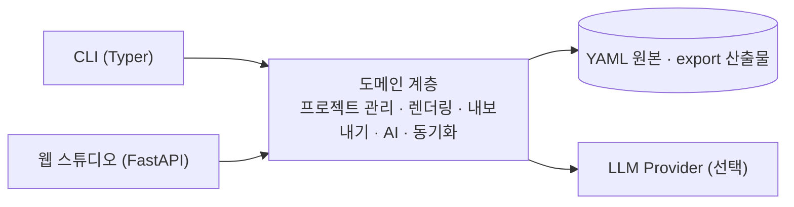

# DevFolio — 프로젝트 포트폴리오

> **아카이브 (2026-11-15):** 이 문서는 **DevFolio 시절의 기록**입니다. 현재 제품은 **성과노트(ImpactNote)** 이며,
> 최신 제품 설명·구조·검증 결과는 `README.md`, `docs/impactnote.md`, `docs/04-architecture.md` 가 기준입니다.
> 아래 내용은 당시의 판단과 측정을 보존하기 위해 수정하지 않았습니다.

> 개발자 채용 제출용 문서입니다. 내부 파일 경로·이슈 번호·분석 메타데이터는 제외하고, 코드로 확인 가능한 설계와 측정된 결과만 담았습니다.

---

## 1. 프로젝트 소개

**DevFolio** — 개발자 경력을 구조화된 데이터로 관리하고, 하나의 원본에서 이력서·경력기술서·포트폴리오를 다시 출력하는 로컬 우선 데스크톱 도구

### 한 줄 소개

같은 경험을 문서마다 다시 쓰지 않도록, 경력을 데이터로 저장하고 문서 형식만 바꿔 재출력하는 도구입니다.

### 프로젝트 배경

지원할 때마다 같은 프로젝트를 이력서에는 한 줄로, 경력기술서에는 세 문단으로, 포트폴리오에는 케이스 스터디로 다시 씁니다. 반복 자체보다 문제는 **불일치**입니다. 어느 문서가 최신인지 알 수 없고, 한 곳을 고치면 나머지는 옛말이 됩니다.

DevFolio는 순서를 뒤집었습니다. 문서를 먼저 쓰지 않고, **경험을 구조화해 저장한 뒤 문서를 렌더링**합니다.

### 해결하려는 문제

| 문제 | 접근 |
|---|---|
| 문서마다 내용이 갈라짐 | 경험 1건 = 데이터 1건. 문서는 렌더링 결과물 |
| 자유 메모와 제출 문서 사이의 구조화 단계 부재 | 자유 텍스트·Git 저장소를 구조화 초안으로 변환 |
| AI를 써도 검토·저장·출력이 이어지지 않음 | 초안 → 사람 검토 → 저장 → 미리보기 → 내보내기를 한 흐름으로 |
| 경력 데이터를 외부 서비스에 맡기는 부담 | 기본은 완전 로컬, 백업은 명시적으로 켤 때만 |

### 대상 사용자

- 지원 시기마다 문서를 다시 쓰는 개인 개발자
- GitHub 이력을 근거로 프로젝트 서술을 만들고 싶은 엔지니어
- 경력 데이터를 직접 보관하려는 사용자

### 핵심 가치

**"한 번 정리하면 세 가지 문서가 된다."** 경험의 유형(실무·개인·학습·토이)과 문서 대상(이력서·경력기술서·포트폴리오)을 태깅해 두면, 문서 종류를 바꿔 같은 원본을 재사용합니다.

### 기술 스택

| 계층 | 기술 |
|---|---|
| 언어 | Python 3.11+ |
| CLI | Typer |
| 웹 API | FastAPI + Uvicorn |
| 모델/검증 | Pydantic v2 |
| 저장 | YAML(ruamel.yaml, 원자적 쓰기, `0600`), platformdirs |
| 문서 렌더링 | Jinja2, Markdown, WeasyPrint(PDF), python-docx(DOCX) |
| AI(선택) | litellm 기반 다중 provider, 함수 내부 지연 로딩 |
| 보안 | keyring → 환경변수 폴백, HTML 허용 목록, iframe sandbox |
| 프론트엔드 | 프레임워크 없는 단일 JS/CSS (빌드 단계 없음) |
| AI 신뢰성 | `ai_reliability.py`(오류 분류·Circuit Breaker·시간 예산), `ai_quality.py`(품질 하한선) |
| 품질 | pytest(334개), ruff, pre-commit, GitHub Actions(3.11/3.12/3.13) |

### 전체 구조

CLI와 웹이 **같은 도메인 계층을 공유**합니다. 두 진입점이 데이터를 다르게 다루지 않는 것이 이 구조의 목적입니다.

### 주요 기능

- 웹 스튜디오에서 경험 CRUD, 섹션별 편집, 자유 텍스트/Git 저장소에서 초안 생성
- 문서 세션 구성(문서 종류 → 포함할 경험 → 톤) 후 실시간 미리보기
- Markdown/HTML/PDF/DOCX/JSON/CSV 내보내기
- AI 요약·작업 문구 생성, JD 매칭
- 선택적 GitHub 백업 동기화, ZIP 백업/복원

---

## 2. 기술적 핵심 사례

### 사례 1 — 같은 원본에서 여러 문서를 만들기: 렌더링을 데이터에서 분리

**Problem**
이력서·경력기술서·포트폴리오는 요구하는 정보 밀도가 다릅니다. 문서별로 편집하면 내용이 갈라집니다.

**Constraints**
- 사용자가 직접 열어 고칠 수 있어야 함(로컬 우선, 계정 없음)
- 문서 종류가 늘어나도 저장 스키마를 다시 만들지 않아야 함
- PDF/DOCX까지 같은 내용이어야 함

**Options**
1. 문서별 파일을 따로 관리 — 단순하지만 원래 문제를 해결하지 못함
2. DB + 웹 서비스 — 다중 기기에는 유리하나 로컬 우선 원칙과 충돌
3. **구조화 모델 + 템플릿 렌더링** — 하나의 원본, 여러 출력

**Decision**
저장 모델(경험·작업·기간·기술·문제해결 사례)과 표현(템플릿)을 분리했습니다. 문서 종류는 렌더링 시점의 파라미터입니다.

**Implementation**
- 경험 데이터는 YAML 1파일 = 1경험으로 저장, 원자적 교체로 부분 손상 방지
- 템플릿은 `base` 상속 구조로 섹션만 교체
- 미리보기와 내보내기가 **같은 Markdown**을 입력으로 사용 → 화면과 산출물의 내용 불일치 차단
- 저장 전 모델 재검증을 명시적 단계로 둠

**Verification**
- 문서 종류 × 템플릿 조합 렌더링과 포맷별 산출물을 테스트로 고정
- 저장 전 초안으로도 미리보기 가능(저장을 강요하지 않음)
- 전체 테스트 334개 통과

**Impact**
문서를 늘리는 비용이 "템플릿 1개 추가"로 줄었습니다. 저장 스키마는 그대로입니다. 또한 미리보기와 실제 산출물이 같은 경로를 쓰므로 "미리보기와 다르게 나오는" 문제가 구조적으로 발생하지 않습니다.

---

### 사례 2 — 외부 LLM을 신뢰하지 않는 부품으로 다루기

**Problem**
LLM은 실패를 정상 응답처럼 돌려줍니다. API 키 문제, 할당량 소진, 지원 종료 모델, 형식 일탈이 모두 "성공"으로 보일 수 있습니다.

**Constraints**
- 여러 provider를 사용자가 자유롭게 등록
- 사용자는 AI 없이도 도구를 써야 함(선택 기능)
- 실패 원인을 사용자가 스스로 확인할 수 있어야 함

**Options**
1. 프롬프트를 정교하게 쓰고 실패는 사용자에게 그대로 전달
2. 실패 시 재시도
3. **응답을 검사하고, 실패 유형을 구분해 다음 후보로 넘어가기**

**Decision**
3번. 재시도는 비용과 시간을 쓰면서 같은 실패를 반복할 수 있습니다. 실패 유형에 따라 "즉시 중단"과 "다음 후보"를 나눴습니다.

**Implementation**
- 표시용 모델명과 실제 생성 모델을 분리하고, 대체가 일어나면 UI에 상태로 노출
- 빈 응답과 "크레딧 부족" 같은 거절 문구를 실패로 판정(HTTP 200이어도)
- 모델 미지원(404)이면 대기 없이 다음 후보로
- 할당량 0과 일일 한도 소진을 구분 — 전자는 즉시 안내, 후자는 대기 후 재시도
- JSON 앞뒤에 붙은 설명문·코드펜스 추출
- 한국어 지시에도 섞이는 외국어 문자 후처리
- 호출마다 provider/모델/지연/문자 수를 파일 로그로 남기고, 설정 화면에서 조회

**Verification**
각 방어에 대해 회귀 테스트를 두고, **방어를 되돌리면 테스트가 실패하는지**를 확인해 기록했습니다. 실제 provider 응답에서 드러난 실패를 재현해 테스트로 고정한 사례가 다수입니다.

**Impact**
AI가 실패해도 "빈 결과가 문서에 저장되는" 최악의 경우를 막았습니다. 실패는 실패로 보이고, 사용자는 설정 화면에서 원인을 확인할 수 있습니다.

**한계와 후속 조치**
초기 방어는 응답의 **형태**만 검사했습니다. 이후 신뢰성 계층을 추가해 다음까지 코드로 판정합니다.

- **오류를 성격으로 분류** — 폐기·인증·400·정책은 영구로 보고 같은 모델을 다시 부르지 않습니다. 429·타임아웃·5xx만 재시도합니다.
- **모델 Circuit Breaker** — 실패한 모델은 파일에 기록해 다음 요청부터 후보에서 제외합니다. 폐기 모델은 영구, 일시 장애는 Cooldown 후 복귀합니다.
- **전체 시간 예산** — 재시도·대기가 90초 예산을 넘으면 남은 후보를 건너뜁니다. 무한 대기를 막습니다.
- **재시도 제어 지점 단일화** — `max_retries=0`으로 라이브러리 내부 재시도를 끄고 애플리케이션 한 곳에서만 결정합니다.
- **품질 하한선(Hard Gate)** — 스키마·필수 필드뿐 아니라, 기술 스택과 문장 속 수치가 저장소 근거에 존재하는지 대조합니다. 통과하지 못하면 완료로 처리하지 않습니다.

여전히 **경력 서술의 사실 확인은 사람의 몫**입니다. 코드가 막는 것은 "근거 없는 기술·수치"까지이고, 문장의 적절성은 심사(ReviewResult)와 사람의 검토가 담당합니다.

---

### 사례 3 — 사용자 데이터를 HTML로 출력할 때의 위험 제거

**Problem**
경력 문서는 사용자가 입력한 텍스트를 HTML로 렌더링합니다. 미리보기는 iframe에서 실행됩니다. 입력에 스크립트가 섞이면 그대로 실행될 수 있는 구조였습니다.

**Constraints**
- 문서는 표·링크·다이어그램(Mermaid)을 표현해야 함 → HTML을 완전히 막을 수 없음
- 로컬 도구지만, 내보낸 HTML은 다른 곳에서 열릴 수 있음

**Options**
1. 모든 HTML 이스케이프 — 안전하지만 표·다이어그램 표현 불가
2. 그대로 출력 + 경고
3. **허용 목록 기반 변환 + iframe 격리 + 다이어그램 strict 모드**

**Decision**
3번. 표현력이 필요한 태그·속성·URL scheme만 허용하고, 나머지는 이스케이프합니다. 미리보기는 `sandbox`로 격리하고 다이어그램은 strict 모드로 제한했습니다.

**Implementation**
- 문서용 태그/속성/URL scheme 허용 목록, 이벤트 핸들러 제거
- 미리보기 iframe sandbox + 접근성 제목
- 위험 입력(script, onerror, SVG onload, `javascript:` 링크)을 테스트 케이스로 고정

**Verification**
위험 입력이 출력에 남지 않는지 테스트로 확인하고, 정상 링크·표·Mermaid 코드는 보존되는지도 함께 고정했습니다.

**Impact**
표현력을 유지하면서 실행 가능한 입력 경로를 제거했습니다. 보안 조치가 기능을 죽이지 않았다는 점을 테스트로 증명한 것이 이 사례의 핵심입니다.

---

### 사례 4 — "검증 장치가 실제로 막는가"를 확인하기

**Problem**
테스트와 CI가 있었지만, 커밋을 실제로 막지 못하는 상태가 오래 지속됐습니다. CI는 연속 실패 중이었고, 로컬 훅은 설치되어 있지 않았습니다.

**Decision**
검증 스크립트를 하나로 모아 git pre-commit과 에이전트 커밋 훅이 **같은 스크립트**를 호출하도록 통일하고, 실패 시 커밋이 중단되도록 종료 코드를 맞췄습니다.

**Verification**
"일부러 실패하는 테스트를 추가하고 커밋", "문법 오류 파일을 추가하고 커밋" 같은 재현 절차를 문서화하고 결과를 기록했습니다.

**Impact**
검증 장치 자체를 검증 대상으로 만든 것이 이 사례의 교훈입니다. 자동화가 있다는 사실과 자동화가 작동한다는 사실은 다릅니다.

---

## 3. 정량적 결과

측정 환경: macOS, Python 3.14.4, 로컬 `devfolio serve`, 격리된 임시 홈 디렉터리에서 시드 데이터 4건으로 확인.

| 지표 | 값 | 측정 방법 |
|---|---|---|
| 테스트 수 | 334개 통과 | `pytest` |
| 보조 텍스트 명암비 | 3.96:1 → **5.62:1** (표면 기준) | 브라우저에서 계산한 WCAG 대비 |
| 모바일 첫 화면 콘텐츠 시작 | 426px → **305px** (390×844) | 요소 좌표 측정 |
| 모바일 내비게이션 높이 | 194px → **73px** | 요소 좌표 측정 |
| 검색 입력 시 DOM 교체 | 전체 재렌더 → **결과 영역만 갱신** | 입력 노드 동일성 확인 |
| 폴더 열기 API | 항상 500 → **200** | 엔드포인트 호출 |

**측정하지 않은 것**: LCP/INP/CLS, 번들 크기, API 응답 시간 분포. Lighthouse를 실행하지 않았으므로 성능 수치를 주장하지 않습니다.

---

## 4. 이 프로젝트에서 보여줄 수 있는 것

1. **데이터 모델과 표현의 분리** — 문서 종류가 늘어도 스키마가 흔들리지 않는 구조
2. **외부 의존(LLM)을 실패하는 부품으로 취급하는 설계** — 실패 유형 구분, 후보 전환, 사용자 가시성
3. **보안과 표현력의 균형** — 허용 목록으로 기능을 유지하면서 위험 경로 제거
4. **검증 장치를 검증하는 규율** — 회귀 테스트가 실제로 막는지 확인하고 기록
5. **점진적 개선** — 프레임워크를 새로 도입하지 않고도 측정 → 수정 → 재측정 사이클을 수행

---

## 5. 한계와 배운 점

- **AI 기능은 실측하지 않았습니다.** API 키와 비용이 필요한 부분은 단위 테스트(모킹)로만 검증되어 있습니다.
- **프론트엔드 자동 테스트가 없습니다.** 브라우저 수동 확인에 의존하며, 이번 개선도 그 방식으로 검증했습니다. 이는 개선 과제입니다.
- **성능 지표를 측정하지 않았습니다.** 체감 개선은 있으나 수치로 주장하지 않습니다.
- **Docker 실행 경로는 검증하지 않았습니다.**
- 협업 방식과 AI 활용 범위는 저장소의 협업 기록 문서에 명시되어 있습니다.

**배운 점**: 로컬 도구일수록 "사용자가 혼자 디버깅한다"는 전제가 중요합니다. 실패를 감추지 않고, 원인을 화면에서 확인할 수 있게 만드는 것이 기능 추가보다 우선이었습니다.
