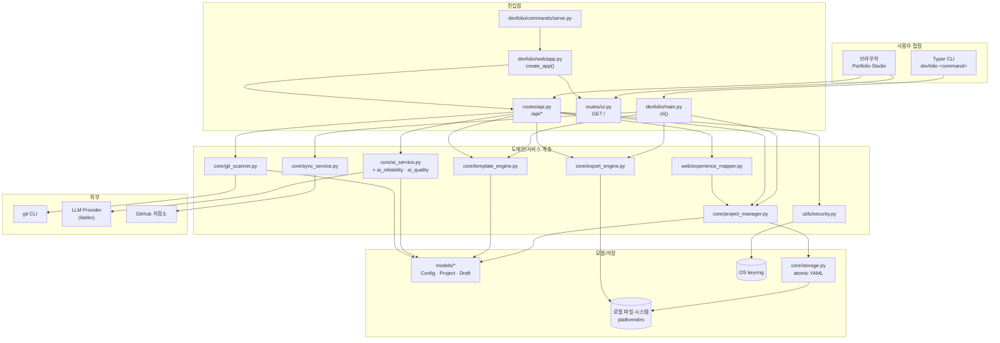
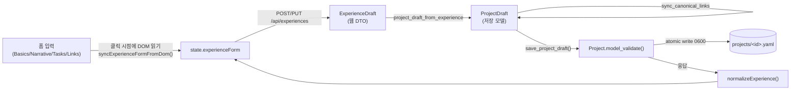
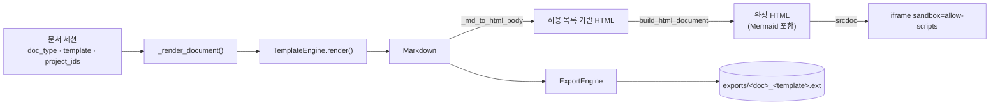
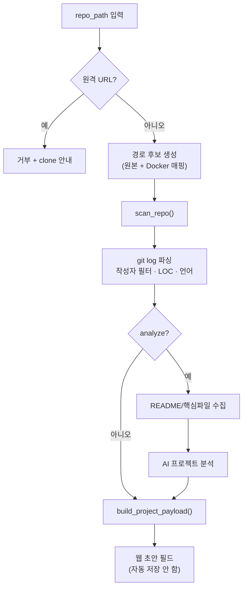
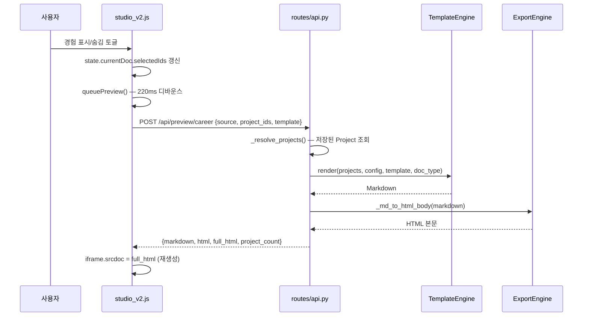
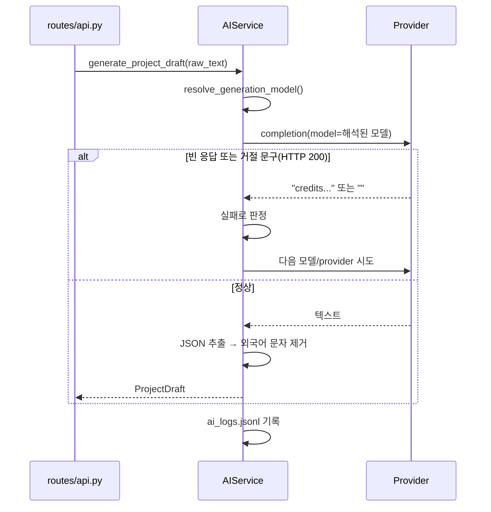
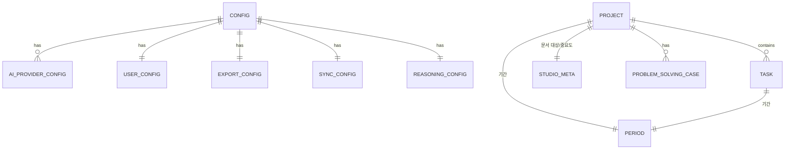
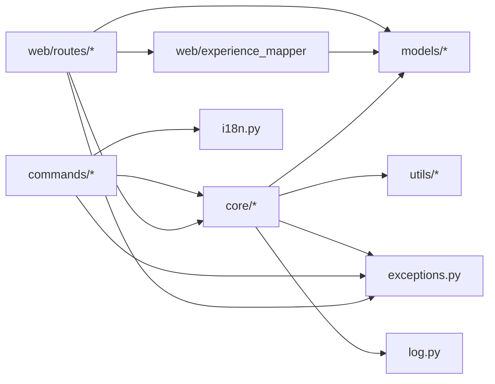
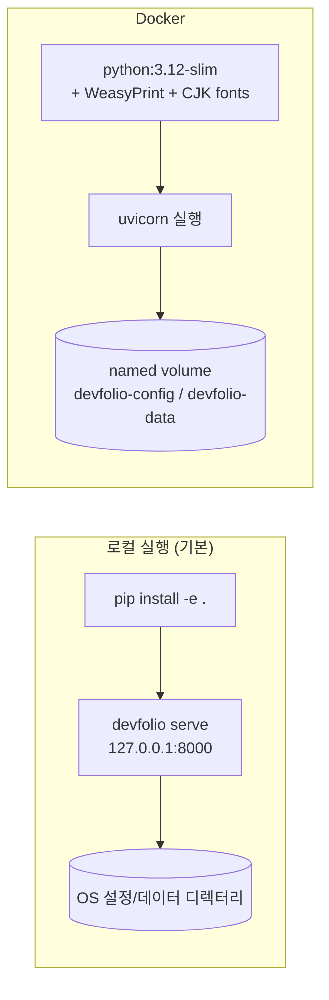

# DevFolio 아키텍처

기준일: 2026-11-15. 다이어그램은 실제 코드 구조를 기준으로 작성했다. 코드에 없는 구성요소(DB, 메시지 큐, 인증 서버)는 등장하지 않는다.

---

## 1. 전체 시스템 아키텍처

진입점은 두 개(CLI / 웹)이고, 둘 다 같은 도메인 계층(`core/`, `models/`)을 공유한다.

### 구성요소의 역할과 선택 이유

| 구성요소 | 역할 | 기술 선택 이유 **[추론]** |
|---|---|---|
| Typer | CLI 서브커맨드 | 타입 힌트 기반 선언만으로 옵션·도움말이 생성되어, Pydantic 모델과 검증 방식을 통일할 수 있다 |
| FastAPI | 로컬 웹 API | 이미 Pydantic을 쓰므로 요청/응답 검증을 같은 도구로 처리. `TestClient`로 서버 없이 계약 테스트 가능 |
| Jinja2 | 문서 템플릿 | `` 상속으로 문서 종류별 섹션만 교체. `base.md.j2` → 각 문서 템플릿 |
| ruamel.yaml | 저장 포맷 | 사람이 직접 열어 수정할 수 있고(로컬 우선), 주석 보존이 가능 |
| platformdirs | 데이터 경로 | OS별 관례 경로 자동 결정. 레거시 `~/.devfolio/`도 인식 |
| keyring | API 키 | 파일에 키를 남기지 않기 위한 1순위 저장소, 실패 시 환경변수 폴백 |
| litellm | LLM 추상화 | provider별 SDK를 각각 다루지 않고 모델 문자열로 전환 |
| 프레임워크 없는 JS | 웹 UI | 빌드 단계 없이 단일 파일로 배포. Docker 이미지에 Node가 필요 없다 |

**트레이드오프 [사실]**: 프레임워크 없는 구조는 빌드 복잡도를 없애는 대신, 상태 관리·부분 갱신·접근성 처리를 직접 구현해야 한다. 이번에 발견한 UI 결함(검색 입력 중 전체 재렌더, 포커스 표시 부재)은 모두 그 비용이다.

### AI 호출 계층의 분리 (2026-11-15 추가)

AI 관련 책임을 세 모듈로 나눴다. 호출 경로는 `routes/api.py → ai_service → (ai_reliability, ai_quality)` 단방향이다.

| 모듈 | 책임 | 하지 않는 일 |
|---|---|---|
| `core/ai_service.py` | 프롬프트 조립, 단계 상태(`AnalysisOutcome`), provider·모델 순회 | 실패 정책 결정, 품질 판정 |
| `core/ai_reliability.py` | 오류 분류(영구/일시), Circuit Breaker, 시간 예산, 백오프 | API 호출, 프롬프트 조립 |
| `core/ai_quality.py` | 스키마·근거 대조 검증(Level 1·2) | 모델 선택, 재시도 |

**재시도 제어 지점은 `_call_single_provider` 하나**다. litellm 내부 재시도는 `max_retries=0`으로 꺼서 애플리케이션 재시도와 중첩되지 않는다.

모델 차단 상태는 데이터 디렉터리의 `ai_model_health.json`에 남는다. 폐기 모델은 영구 차단, 일시 장애는 Cooldown(기본 300초) 후 다시 후보에 들어간다. **[사실]**

**[추론]** 이 분리의 목적은 테스트 가능성이다. 오류 분류·차단·품질 판정이 모두 순수 함수·작은 상태 객체라 실제 API 없이 검증된다(`tests/test_ai_reliability.py` 41개). 호출 경로에 정책이 섞여 있으면 이 중 어느 것도 단독으로 고정하기 어렵다.

---

## 2. 핵심 기능별 데이터 흐름

### 2.1 경험 저장 (웹)

폼 상태를 **입력 이벤트마다**가 아니라 **행동 시점에** DOM에서 읽는다. 이 선택 때문에 입력 중 재렌더가 곧 데이터 손실이 될 수 있다. 이번 수정에서 검색 입력만 예외적으로 부분 갱신으로 바꾼 이유가 여기에 있다.

### 2.2 문서 렌더링 (미리보기 → 내보내기)

미리보기와 내보내기가 **같은 Markdown을 입력으로** 쓴다. 그래서 미리보기와 실제 산출물이 형식만 다르고 내용은 같다.

### 2.3 Git 스캔

캐시 판단은 저장된 프로젝트의 `last_commit_sha`와 HEAD 비교로 한다. `analyze=True`면 캐시를 건너뛴다.

---

## 3. 주요 시퀀스

### 3.1 문서 미리보기 요청

디바운스는 있으나, 응답 후 `render()`가 전체 DOM을 다시 만들기 때문에 iframe도 매번 새로 생성된다.

### 3.2 AI 호출 실패와 폴백 **[사실]**

이 폴백·감지 로직은 `docs/agent-incidents.md`의 INC-01, 02, 03, 05, 09, 12와 대응한다.

---

## 4. 데이터 모델

**DB는 존재하지 않는다.** 관계형 ERD 대신 파일 기반 스키마를 적는다. **[사실]**

| 파일 | 모델 | 특징 |
|---|---|---|
| `config.yaml` | `Config` | `ai_providers[]`, `user`, `export`, `sync`, `reasoning`. 권한 `0o600` |
| `projects/<id>.yaml` | `Project` | 1 프로젝트 = 1 파일. `tasks[]`, `studio_meta`, `period` |
| `ai_logs.jsonl` | (dict) | append-only 호출 로그. `/api/ai-logs`는 최근 N건만 반환 |

`Project`와 `ExperienceDraft`는 필드 이름이 다르다(`name`↔`title`, `type=company|side|course`↔`work|personal|study|toy`). 이 차이는 `experience_mapper.py`가 흡수한다.

### 저장 안전성 **[사실]**

`storage._atomic_write()`는 같은 디렉터리에 임시 파일을 만들고 `flush → fsync → chmod 0600 → os.replace` 순서로 교체한다. 직렬화가 중간에 실패해도 원본이 잘리지 않는다(INC-15의 조치).

---

## 5. 모듈 의존 관계

- `models/`는 어떤 계층도 import하지 않는다(최하위).
- `core/`는 `models/`, `utils/`, `exceptions`, `log`에만 의존한다.
- `web/`과 `commands/`가 같은 `core/`를 공유하는 것이 이 프로젝트의 핵심 구조다. CLI와 웹이 데이터를 다르게 다루지 않는 이유다.

### 선택 의존성 격리 **[사실]**

`litellm`, `weasyprint`, `docxtpl`/`python-docx`, `fastapi`는 모두 **함수 내부에서 import**한다. 기본 설치(`pip install devfolio`)만으로 CLI가 동작하고, 웹은 `create_app()`에서 ImportError를 잡아 설치 안내로 바꾼다.

---

## 6. 배포 구조

서버리스·PaaS 배포는 코드에 없다. README도 "hosted web service가 아니라 소스 중심 CLI 도구"라고 명시한다. **[사실]**

---

## 7. 아키텍처 관점의 관찰

**[사실]** 계층 분리(`models` ← `core` ← `commands`/`web`)는 일관되게 지켜진다. 반면 프론트엔드는 단일 파일·전역 상태·전체 재렌더 구조다.

**[추론]** 이 비대칭이 실무적 부담으로 나타난다. 서버는 계약 테스트가 두텁지만(API 테스트 20여 개), 클라이언트는 테스트가 없어 회귀를 코드 리뷰로만 잡아야 한다. 이번에 발견한 6건의 UI 결함 중 3건(검색 입력 재렌더, `data-screen` 우선 처리, 모달 키보드 처리)은 브라우저에서 직접 확인하지 않으면 드러나지 않는 유형이었다.

**[가설]** 장기적으로는 (a) 화면별 렌더 함수 분리 + 부분 갱신, (b) 최소한의 브라우저 스모크 테스트 도입이 비용 대비 효과가 크다. 다만 빌드 도구 도입은 Docker 이미지 크기·CI 시간과 교환 관계이므로 지금 단계에서 정당화되지 않는다.
