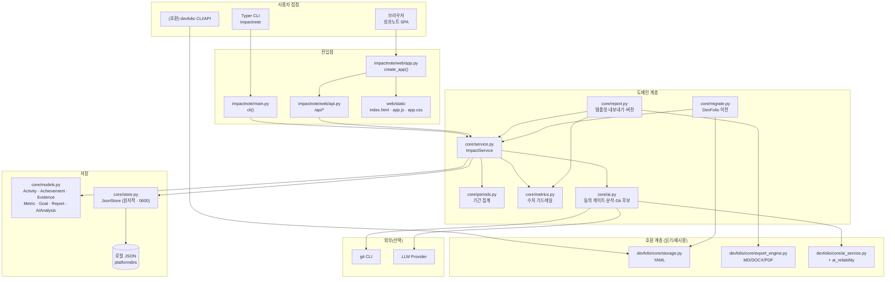

# 성과노트(ImpactNote) 아키텍처

기준일: 2026-11-15, 버전 1.0.0. 코드에 존재하는 구성요소만 기술한다(DB 서버, 메시지 큐, 인증 서버 없음).

---

## 1. 전체 구조



### 설계 요점

- **단일 서비스 계층**: CLI 와 HTTP API 가 같은 `ImpactService` 를 호출한다. 화면 로직에 도메인 규칙을 두지 않는다.
- **저장과 해석 분리**: Activity 는 사실, Achievement 는 해석, AIAnalysis 는 제안이다. AI 결과가 원본을 덮어쓰지 않는다.
- **가드레일은 서비스 경계에 배치**: 수치 검증·상태 계산·동의 확인을 API/화면이 아니라 `core` 에서 강제한다.
- **레거시는 읽기·재사용만**: 기존 YAML·내보내기 엔진·AI 신뢰성 계층을 재사용하되 DevFolio 데이터는 수정하지 않는다.

---

## 2. 요청 흐름

### 2.1 업무 기록 저장

```
브라우저 폼 → POST /api/activities → ImpactService.create_activity()
  → Pydantic Activity 검증(날짜·기간)
  → JsonStore.put("activities") : 임시 파일 + os.replace, chmod 0600
  → 응답 {status, activity}
```

제목·설명만 있으면 날짜는 오늘로 채워지고 나머지는 기본값이다.

### 2.2 성과 상태 계산

```
Achievement 생성/수정/근거 연결
  → ImpactService._apply_status()
      ├─ source ∈ {ai, git} and not confirmed → needs_review
      ├─ 연결 근거가 모두 verified          → verified
      ├─ 일부만 verified                    → partially_verified
      ├─ 근거가 있거나 needs_review          → needs_review
      └─ 그 외                              → user_input
```

상태는 저장 시점에 계산해 함께 보관하므로 목록·대시보드가 재계산 없이 일관된다.

### 2.3 수치 가드레일

```
AI 결과 텍스트 / 지표 / 보고서 문장
  → find_claims(): 숫자+단위 추출
  → unsupported_claims(): 기록·근거·지표의 숫자 집합과 대조
  → sanitize_claims(): 불일치 시 "[확인 필요]" 치환 + unverified_metrics 기록
  → 보고서: Metric.verified == True 만 본문 사용, 나머지는 확인 필요 부록
```

이 경로는 `sanitize_ai_result`(AI)와 `report.build_content`(문서) 양쪽에서 재사용된다.

### 2.4 보고서 생성

```
POST /api/reports {template, period_kind, reference|start,end, format}
  → periods.resolve_period() : 주/월/분기/반기/연/사용자 지정
  → select_activities/select_achievements : 기간 겹침 기준
  → build_content() : 템플릿별 섹션 + 검증 지표 + 확인 필요 부록
  → create_report() : 버전 계산(v1→v2), JSON 저장, ExportEngine 으로 파일 생성
  → GET /api/reports/{id}/download?format=md|docx|pdf|txt|csv
```

### 2.5 DevFolio 이전

```
POST /api/migrate 또는 impactnote migrate
  → _legacy_projects(): IMPACTNOTE_LEGACY_DATA_DIR/projects/*.yaml 우선,
                        없으면 devfolio 기본 저장소로 폴백
  → _backup(): 레거시 data/config 를 ZIP 으로 백업 (impactnote 데이터 디렉터리/backups)
  → 프로젝트 작업 → Activity(source=migration, source_ref=legacy:<p>:<t>)
  → 문제/해결/결과가 있으면 Achievement(source=migration, needs_review)
  → migration.json 지문 저장 → 재실행 시 already_migrated
```

---

## 3. 데이터 모델

| 모델 | 핵심 필드 | 불변 규칙 |
| --- | --- | --- |
| `Activity` | title, description, date, period_end, project, type, problem/action/result, status, importance, tags, collaborators | 종료일 ≥ 시작일, 날짜 형식 `YYYY-MM-DD` |
| `Achievement` | title, problem, action, result, impact_categories, contribution, activity_ids, evidence_ids, status, source, confirmed | 기간 역전 금지, 상태는 서버 계산 |
| `Evidence` | type, title, reference, description, verified | 알 수 없는 type 은 `url` |
| `Metric` | name, value, unit, period, basis, evidence_id, verified | 근거/산출 기준 없으면 verified 불가 |
| `Goal` | title, target, actual, unit, note | — |
| `Report` | title, template, period, content, format, file_name, version, status | 상태는 `draft`/`submitted` |
| `AIAnalysis` | activity_id, status, result, error_code, provider, model | 결과는 별도 컬렉션, 원본 불변 |
| `Settings` | user_name, role, default_template, external_ai_consent, allowed_providers | 동의 기본값 `False` |

저장 컬렉션: `activities`, `achievements`, `evidence`, `metrics`, `goals`, `reports`, `analyses`, `settings`.

---

## 4. AI 신뢰성 계층

AI 호출은 기존 `devfolio/core/ai_service.py` 의 `_call(...)` 을 재사용한다.

```
impactnote/core/ai.py
  ├─ 동의 확인 (EXTERNAL_AI_NOT_ALLOWED)
  ├─ 허용 Provider 확인
  ├─ AIService._call(system, user, json_mode=True, telemetry=...)
  │     └─ Provider 순회 · 모델 순회 · 재시도 · 차단 · JSON 추출
  └─ sanitize_ai_result() → AIAnalysis 저장(status=completed|failed)
```

- 오류 분류·백오프·모델 차단 정책은 `docs/ai-reliability.md` 를 따른다.
- 실패해도 `AIAnalysis(status="failed", error_code=...)` 만 남고 Activity 는 변경되지 않는다.
- 실패한 분석은 `apply` 할 수 없다(400).

---

## 5. 웹 계층

- `create_app()`: FastAPI 앱, `/` SPA, `/favicon.svg`, `/static`, `/api` 라우터
- SPA 는 상태를 메모리에 두고 API 만 호출한다(서버 템플릿 없음).
- 주요 API: `/api/health`, `/meta`, `/dashboard`, `/activities`, `/achievements`, `/evidence`, `/metrics`, `/ai/analyze`, `/ai/analyses/{id}/apply`, `/git/import`, `/reports`, `/settings`, `/migrate`
- 파일 다운로드는 `ExportEngine` 산출물을 스트리밍한다.

---

## 6. 배포·운영

| 항목 | 내용 |
| --- | --- |
| Docker | `docker compose up -d --build`, 서비스 `impactnote`, 포트 8000 |
| 볼륨 | `impactnote-data`, `impactnote-config` (신규) / `devfolio-data`, `devfolio-config` (읽기 전용 마운트) |
| 환경변수 | `IMPACTNOTE_*`, AI Provider 키, `REPOS_DIR` |
| 상태 확인 | `GET /api/health` → `{status, app, version, storage}` |
| 검증 | `scripts/check.sh` (ruff + format + pytest), `tests/test_impactnote.py` |

단일 사용자·로컬 실행 전제이며, 인증·다중 사용자·클라우드 동기화는 포함하지 않는다.

---

## 7. 레거시 호환

`devfolio/` 는 다음 자산을 제공하기 위해 유지된다.

- YAML 프로젝트/작업 데이터와 기존 CLI·웹 API
- `export_engine` (MD/DOCX/PDF/TXT/CSV 렌더링)
- `ai_service` + `ai_reliability` + `ai_observability` (재시도·차단·관측)
- 기존 테스트 401개(회귀 안전망)

새 기능은 `impactnote/` 에만 추가하고, 레거시 코드는 마이그레이션·내보내기·AI 호출에 필요한 최소 수정만 한다.
