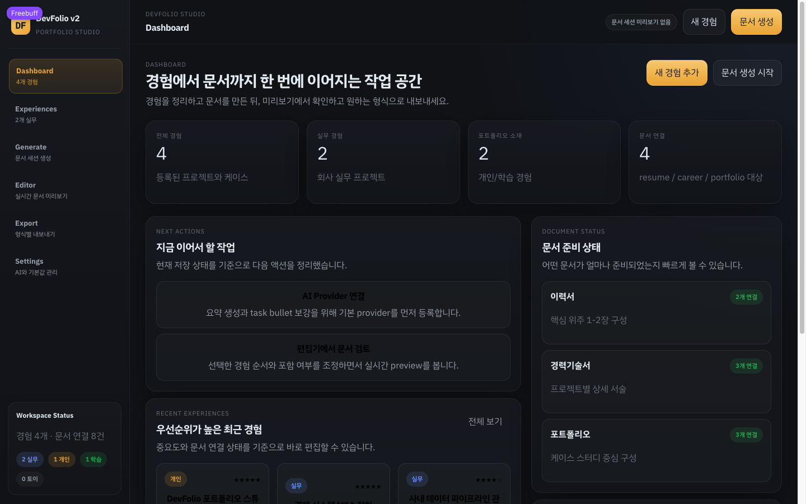
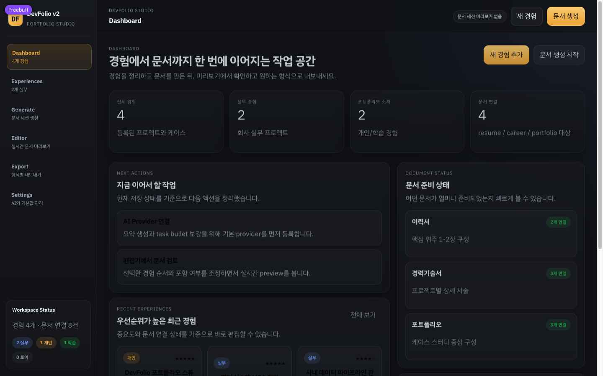
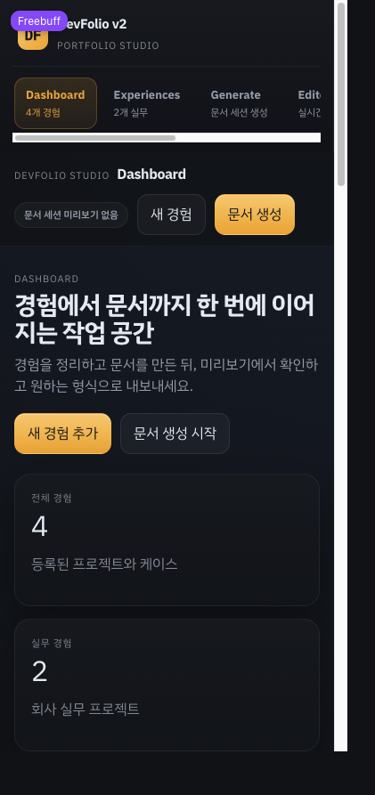

# UI/UX 감사 및 개선

> **아카이브 (2026-11-15):** 이 문서는 **DevFolio 시절의 기록**입니다. 현재 제품은 **성과노트(ImpactNote)** 이며,
> 최신 제품 설명·구조·검증 결과는 `README.md`, `docs/impactnote.md`, `docs/04-architecture.md` 가 기준입니다.
> 아래 내용은 당시의 판단과 측정을 보존하기 위해 수정하지 않았습니다.

기준일: 2026-11-15
대상: `devfolio serve` Portfolio Studio (`/` → `studio_v2.css` + `studio_v2.js`)
방법: 격리된 임시 홈 디렉터리에서 서버 실행 → 실제 브라우저(Chromium)에서 화면 확인·요소 측정 → 코드 수정 → 동일 조건 재측정

---

## 1. 기존 UI 분석

### 정보 구조

6개 화면: Dashboard → Experiences(목록/편집기) → Generate(4단계) → Editor → Export → Settings(5탭).

**[사실]** 구조 자체는 사용자 목적과 일치한다. "경험 정리 → 문서 세션 구성 → 미리보기 → 내보내기"가 화면 순서와 같다. 대시보드의 "지금 이어서 할 작업"이 현재 상태로 다음 행동을 안내한다.

**[추론]** 문제는 구조가 아니라 **실행 품질**이었다. 아래 항목은 브라우저에서 실제로 확인한 결함이다.

### 발견한 문제

| # | 문제 | 재현 절차 | 근본 원인 (코드) | 심각도 |
|---|---|---|---|---|
| 1 | 보조 텍스트 명암비 부족 | 화면 진입 후 `--text-3` 사용 요소(eyebrow, hint, mini-copy) 확인 | `--text-3: #6f7a86` → 표면 대비 3.96:1 (AA 기준 4.5:1 미달) | High |
| 2 | 키보드 포커스 표시 없음 | Tab으로 버튼/탭/카드 이동 | `.btn:hover, .btn:focus-visible { outline: none }` — 포커스 표시를 명시적으로 제거. 카드·탭에는 포커스 스타일 자체가 없음 | High |
| 3 | 카드형 버튼 텍스트 중앙 정렬 | Dashboard "지금 이어서 할 작업" 카드 확인 | `<button>` UA 기본값 `text-align: center`를 덮지 않아, 같은 패널의 좌측 정렬 텍스트와 어긋남 | Low |
| 4 | 모션 감소 설정 미지원 | OS에서 "동작 줄이기" 후 사용 | `prefers-reduced-motion` 규칙 없음. 화면 진입 페이드·호버 이동·스피너 회전 모두 유지 | Medium |
| 5 | 검색 입력이 한 글자마다 전체 재렌더 | Experiences에서 한글 검색어 입력 | `handleInput` → `render()` → `root.innerHTML` 교체. 입력 노드가 매번 파괴되어 IME 조합·커서 위치가 초기화될 수 있음 | High |
| 6 | 빈 상태 CTA가 동작하지 않음 | 경험 0건 상태에서 Dashboard의 "첫 경험 추가" 클릭 | `handleClick`이 `data-screen`을 먼저 처리하고 `return` — 같은 요소의 `data-action`이 실행되지 않음. 목록 화면으로만 이동 | Medium |
| 7 | 초기 로딩 실패를 구분할 수 없음 | 서버 중지 후 페이지 진입 | 실패 시 토스트(2.4초)만 표시되고 빈 대시보드로 전환. "데이터 없음"과 "불러오기 실패"를 구분할 수 없고 재시도 수단 없음 | High |
| 8 | 요청 타임아웃·네트워크 오류 처리 없음 | 서버가 응답하지 않는 상태에서 새로고침 | `fetch`에 `AbortController`/타임아웃 없음. 네트워크 실패 시 원시 오류 메시지 | Medium |
| 9 | 모달 키보드 이탈 경로 없음 | 폴더 선택 모달을 열고 ESC | `keydown` 핸들러 자체가 없음. `role="dialog"`, `aria-modal` 없음 | Medium |
| 10 | 토스트가 스크린리더에 전달되지 않음 | 저장 후 토스트 확인 | 라이브 리전 없음. 매 렌더마다 DOM이 교체되어 새 노드 삽입으로는 안정적 통지 불가 | Medium |
| 11 | 편집기에서 Enter가 아무 동작도 하지 않음 | 경험 편집 입력란에서 Enter | 편집 폼(`#experience-editor`)에 대한 `submit` 처리 없음. `preventDefault`만 되고 저장되지 않음 | Low |
| 12 | 모바일에서 내비게이션이 첫 화면을 잠식 | 390px 폭에서 Dashboard 진입 | 6개 항목이 2열 그리드(높이 194px)로 배치되어 콘텐츠가 426px 아래에서 시작 | Medium |
| 13 | 모바일 상단바가 어중간하게 감김 | 390px 폭 확인 | `.topbar`는 `flex-wrap` 없음 + `.topbar-actions`만 wrap → 상태 pill과 버튼이 어색하게 줄바꿈 | Low |
| 14 | 모바일에서 토스트가 화면 밖으로 길어짐 | 좁은 화면에서 토스트 표시 | `right: 22px` 고정 + `min-width: 260px` | Low |

### 접근성 점검 결과 (수정 전)

| 항목 | 상태 |
|---|---|
| 색 대비 (본문) | 통과 (`--text` 16:1) |
| 색 대비 (보조 텍스트) | **미달** 3.96:1 |
| 키보드 포커스 표시 | **미달** (버튼·카드·탭) |
| 폼 레이블 | 대체로 양호 (`<label>`로 감싼 필드 다수) |
| 모달 시맨틱 | **없음** |
| 상태 알림 | **없음** |
| 모션 감소 | **미지원** |
| 이미지 대체 텍스트 | 해당 없음(아이콘은 텍스트 문자 사용) |

---

## 2. 디자인 리서치

유사 서비스 3종의 **구조적 접근**만 참고했고, 시각 스타일을 복제하지 않았다.

| 서비스 유형 | 참고한 점 | 이 프로젝트에 적용한 방식 |
|---|---|---|
| 구조화 이력 관리 도구(경력 데이터 → 다중 출력) | 원본 1개 + 출력 N개를 화면에서 명시 | 대시보드의 "문서 준비 상태"(문서별 연결 경험 수) 유지·강화 |
| 개발자용 문서/노트 도구 | 좌측 내비 + 작업 영역 분리, 섹션 단위 편집 | 기존 구조 유지(이미 적절). 모바일에서 내비를 압축 |
| 이력서 빌더 | 단계형 마법사 + 실시간 미리보기 | Generate 4단계 흐름 유지, 미리보기 디바운스 유지 |

**도출한 방향**: 화면 구조는 이미 목적에 맞으므로 **재설계하지 않는다.** 대신 (a) 읽기 품질(대비·타이포), (b) 키보드 접근, (c) 실패·빈 상태의 명시성, (d) 작은 화면의 밀도 개선에 집중한다.

---

## 3. 적용한 디자인 시스템 변경

기존 토큰 체계(`--bg/--surface/--text/--accent/--radius`)를 유지하고 **값과 상태 정의만** 보완했다. 새 팔레트·새 라이브러리·새 컴포넌트 세트는 도입하지 않았다.

| 토큰/규칙 | 변경 전 | 변경 후 | 이유 |
|---|---|---|---|
| `--text-3` | `#6f7a86` (3.96:1) | `#8b949e` (5.62:1) | AA 4.5:1 충족. eyebrow·hint·mini-copy가 모두 이 토큰을 쓴다 |
| `--focus` | 없음 | `#7dc4ff` | 포커스 링 전용 색. 액센트(주황)와 구분해 선택 상태와 혼동 방지 |
| `:focus-visible` | 없음 | `2px solid var(--focus)` + `offset 2px` | 키보드 사용자에게 현재 위치 제공 |
| 입력 포커스 | border+shadow | 유지, `outline`만 제거 | 기존 표시가 이미 명확해 중복 제거 |
| `.card-button` 정렬 | 중앙 | 좌측 | 같은 패널 내 텍스트 정렬 통일 |
| `.doc-target-hint` | `opacity: .5` | 불투명 + 색으로 구분 | 투명도로 대비를 낮추면 AA 미달 |
| `.log-ts`, `.log-meta` | `#6e7681`/`#8b949e` | `var(--text-3)` | 토큰 일원화 |
| `prefers-reduced-motion` | 없음 | 장식 모션 제거 + 호버 이동 해제 | 사용자 설정 존중 |

---

## 4. 화면별 개선 (Before / After)

### Dashboard

- **Before**: 보조 텍스트가 흐릿하고, 빈 상태의 "첫 경험 추가" 카드가 목록으로만 이동.
- **After**: 보조 텍스트 대비 5.62:1, "첫 경험 추가"가 새 경험 편집기(Intake)를 바로 연다.

### Experiences

- **Before**: 검색 입력 시 전체 DOM 교체. 카드 텍스트 정렬이 패널과 불일치.
- **After**: 결과 영역만 갱신(`#experience-results`), 입력 노드·커서·한글 조합 유지. 카드 좌측 정렬.

### 모바일 (390×844)

- **Before**: 내비게이션 2열 그리드(194px) → 콘텐츠가 426px 지점에서 시작.
- **After**: 한 줄 가로 스크롤(73px) → 콘텐츠 305px에서 시작. 상단바를 2행으로 명시 분리.

| 지표 | Before | After |
|---|---|---|
| 내비 높이 | 194px | 73px |
| 콘텐츠 시작 | 426px | 305px |
| 절감 | — | **121px (뷰포트 높이의 14%)** |

### 상태 디자인

| 상태 | Before | After |
|---|---|---|
| 로딩 | 텍스트만 | 유지 + `role="status"` |
| **실패** | 토스트 2.4초 후 빈 화면 | 전용 오류 화면 + "다시 시도" + 확인 항목 안내 |
| 빈 상태 | 문구만 | 유지, CTA 동작 수정 |
| 성공 알림 | 시각적 토스트 | 유지 + 라이브 리전 통지 |

---

### AI 분석 상태 표시 (2026-11-15 추가)

Git 스캔과 AI 딥 분석을 함께 실행하면, 기본 정보 섹션 위에 분석 리포트가 표시된다.

| 요소 | 표시 내용 |
|---|---|
| 모델 | 실제 생성에 사용된 모델 ID(`provider/model`) |
| 자동 전환 | 대체 모델로 넘어간 경우 경고 배지 |
| 단계 | Git 스캔 / AI 초안 / 문제 해결 사례 / 품질 검증 각각의 상태 |
| 품질 검증 | 통과·미통과와 근거 부족 항목(최대 4개) |

실패해도 화면이 비지 않는다. 기본 스캔 결과는 그대로 채워지고, "AI 재분석" 버튼으로 실패한 단계만 다시 실행할 수 있다. 서버 내부 예외 문자열은 그대로 노출하지 않고 단계 상태와 사유만 보여준다.

> **검증 범위 고지**: 이 패널은 `node --check`(문법)와 API 응답 구조로만 확인했고, **브라우저에서 실제 렌더링을 보지 않았다.** 기존 디자인 토큰을 쓰도록 작성했지만 색 대비·간격의 육안 확인은 미실시다.

---

## 5. 남은 과제

| 항목 | 이유 |
|---|---|
| `app.js`/`style.css`(약 4.3k 줄) 미사용 코드 | 다른 브랜치와 충돌 위험. 별도 정리 커밋 권장 |
| 전체 재렌더 구조 | 화면별 부분 갱신으로의 전환은 큰 변경. 이번에는 검색만 국소 수정 |
| 모달 포커스 트랩 | ESC·초기 포커스·`aria-modal`은 추가했으나, Tab 순환이 배경으로 나갈 수 있음 |
| 키보드 드래그 대체 수단 | 섹션 순서 변경이 마우스 드래그 전용 |
| 대비 재검증 자동화 | axe 등 자동 감사 미도입(의존성 추가 필요) |
| 다크 전용 | 라이트 테마 없음 |

> **검증 범위 고지**: 수정 후 화면은 실제 브라우저에서 확인했고, 색 대비·요소 좌표·노드 동일성은 계산값으로 확인했다. 다만 스크린리더(VoiceOver/NVDA)로 직접 청취 검증은 하지 않았고, Lighthouse/axe 자동 감사도 실행하지 않았다.
