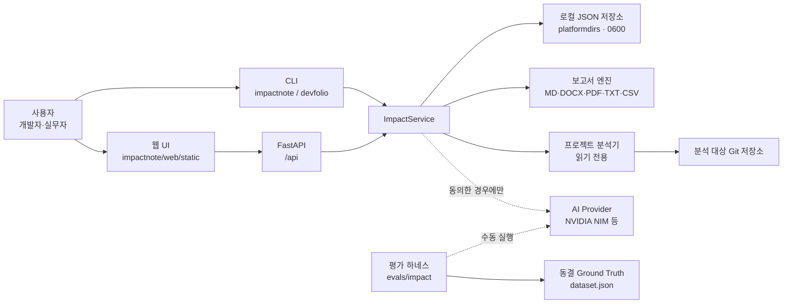
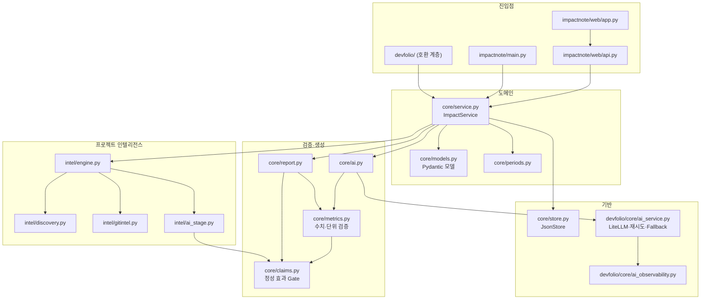
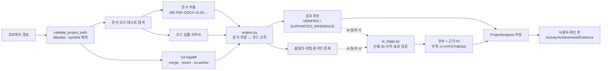
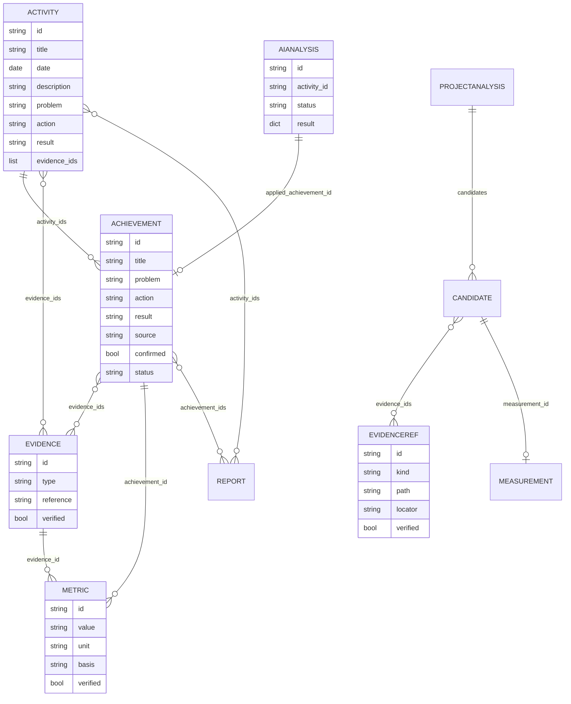
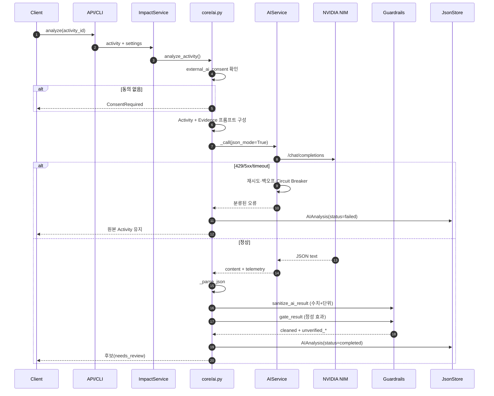
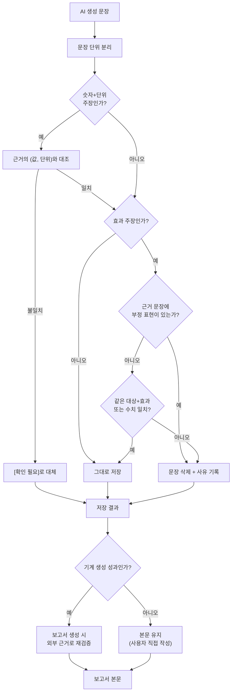
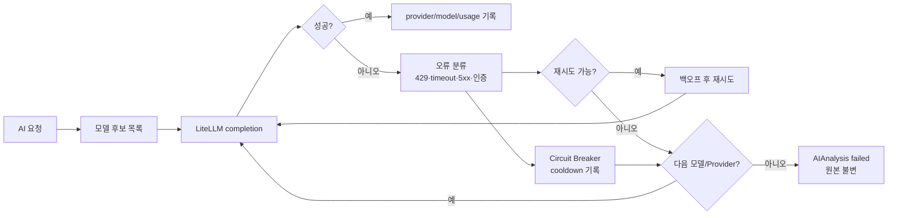
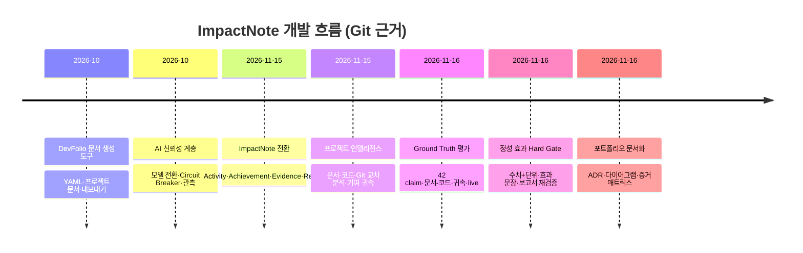
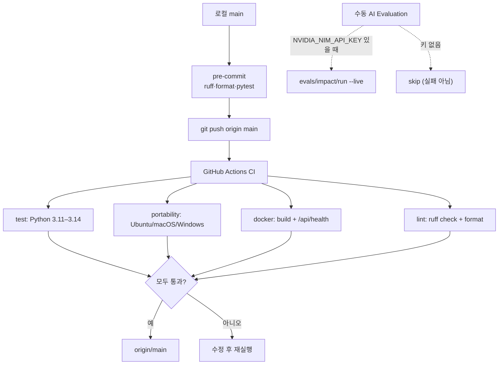
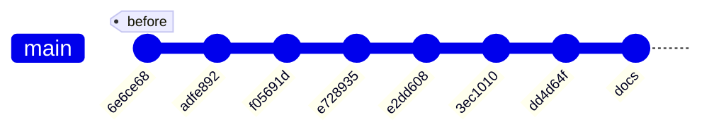

# ImpactNote 아키텍처 다이어그램

기준: 2026-11-16 · 코드 `main` (문서 커밋 직전 `dd4d64f`)
대상: `impactnote/`, `devfolio/`, `evals/impact/`

> 다이어그램은 실제 코드 구조를 기준으로 한다. 구현에 없는 컴포넌트는 넣지 않았다.
> 점선은 선택 기능(외부 AI 동의, 수동 평가)을 뜻한다.

## 범례

| 표기 | 의미 |
| --- | --- |
| 실선 | 항상 실행되는 경로 |
| 점선 | 설정·동의·수동 실행이 있어야 하는 경로 |
| `[확인 필요]` | 근거 없는 수치를 대체하는 표시 |
| HYPOTHESIS | 근거가 부족해 확정하지 않은 후보 |

---

## Diagram 1. System Context

- 사용자 데이터는 기본적으로 로컬에만 저장된다.
- 외부 전송은 `Settings.external_ai_consent`가 켜져야 한다.
- 분석 대상 저장소는 `IMPACTNOTE_ANALYZE_ROOTS` allowlist 안에서만 읽는다.

## Diagram 2. Container / Component Architecture

- `service.py`가 CRUD·상태 계산의 단일 진입점이다.
- `metrics.py`와 `claims.py`는 저장·보고서 양쪽에서 재사용된다.
- `devfolio/`는 삭제하지 않고 Provider·내보내기·레거시 API 호환에 사용한다.

## Diagram 3. Project Intelligence Pipeline

- AI는 `VERIFIED`를 만들 수 없다. 최대 `SUPPORTED_INFERENCE`다.
- 인용 ID가 근거 목록에 없으면 후보에서 제외한다.
- 커밋 메시지의 `+N/-N`은 개선 효과의 측정 근거로 쓰지 않는다.

## Diagram 4. Evidence Graph / Data Model

현재 구현에는 별도 `Claim` 테이블이 없다. Claim 검증 결과는
`AIAnalysis.result.unverified_effects`와 `ProjectAnalysis` 후보의 품질 라벨로 남는다.
그래프 DB가 아니라 **ID 참조 집합**이다.

## Diagram 5. AI Generation Sequence

## Diagram 6. Hallucination Prevention Flow

- 수치 검증은 `normalize_unit`으로 `10m`와 `10분`을 같게 본다.
- `80%`는 `80ms`로 통과하지 않는다.
- 효과 주장이 아니면 Gate는 문장을 건드리지 않는다.

## Diagram 7. AI Provider Fallback

현재 `nvidia_nim`은 `openai/gpt-oss-20b`만 허용한다. 계정별 접근 모델이 달라
모델 목록을 넓게 두지 않는다.

## Diagram 8. Git Evolution Timeline

`timeline`은 GitHub Mermaid에서 지원되지만, 렌더러 버전에 따라 표시가 다를 수 있다.
Git 이력 원문은 `git log --oneline --graph`로 확인한다.

## Diagram 9. CI/CD & Deployment

Docker는 `127.0.0.1`에만 바인딩하고, 컨테이너에서는 `serve --host 0.0.0.0`으로
내부 포트를 연다. 인증이 없는 API를 LAN에 노출하지 않기 위한 설정이다.

## Diagram 10. Commit / Merge History (이번 작업)

| 순서 | Commit | 목적 |
| ---: | --- | --- |
| 0 | `6e6ce68` | 작업 시작 HEAD (origin/main과 동기화) |
| 1 | `adfe892` | NVIDIA NIM Provider·응답 안정성 |
| 2 | `f05691d` | 수치·정성 효과 Guardrail |
| 3 | `e728935` | 프로젝트 인텔리전스·기여 귀속 |
| 4 | `e2dd608` | Ground Truth 평가·A/B 하네스 |
| 5 | `3ec1010` | Docker·CI·이식성 |
| 6 | `dd4d64f` | NVIDIA gpt-oss 토큰 하한 회귀 테스트 |
| 7 | `docs` | 아키텍처·개발사·포트폴리오 문서 |

실제 문서 커밋 SHA는 `git log -1 --oneline`으로 확인한다. 이 저장소는 별도
Integration Branch를 만들지 않고 `main`에 순차 커밋했다(AGENTS.md 규칙).

## 렌더링 검증

- Mermaid CLI(`mmdc`)는 이 환경에 설치되어 있지 않아 **로컬 렌더링을 수행하지 않았다**.
- 대신 코드 펜스·다이어그램 선언·노드 참조를 스크립트로 검사했다.
- GitHub Markdown 렌더링은 실제 push 후 저장소 화면에서 확인해야 한다.
