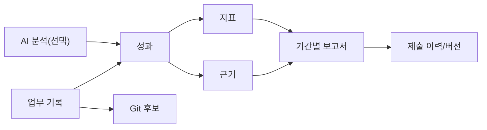
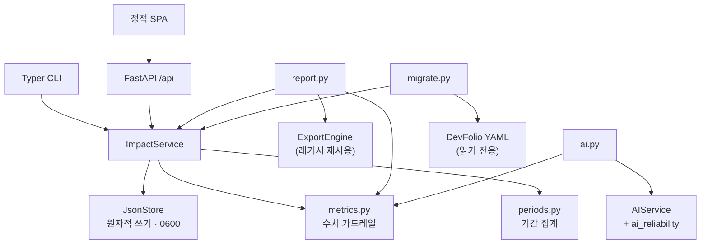

# 성과노트(ImpactNote) — 백엔드 포트폴리오

> 파일명은 링크 호환을 위해 유지한다. 이전 제품 DevFolio 의 백엔드 서술은 `docs/01`·`docs/02` 아카이브에 남아 있다.

## 한 줄 소개

업무 기록·성과·근거·지표를 도메인으로 분리하고, 근거 없는 수치를 코드로 차단하며,
기간별 제출 보고서를 결정론적으로 생성하는 로컬 우선 백엔드.

## 왜 만들었는지

기존 DevFolio 는 "경력을 데이터로 저장해 문서를 렌더링"하는 도구였다. 하지만 회사 업무 맥락에서는
문서 생성보다 **기록의 소실**과 **근거의 부재**가 더 큰 문제였다.

- 평가 시즌에 업무를 기억하지 못한다.
- 숫자를 쓰고 싶어도 출처를 댈 수 없다.
- 팀 성과와 개인 기여가 섞인다.

그래서 문서 생성 백엔드를 **기록 → 성과 → 근거 → 보고서** 파이프라인으로 재설계했다.

## 해결하려는 문제와 백엔드 대응

| 문제 | 백엔드 구현 |
| --- | --- |
| 기록이 남지 않음 | `Activity` 최소 필드 저장(제목·설명·날짜), 이후 보완 |
| 근거 없는 수치 | `metrics.py` 의 주장 추출·대조·`[확인 필요]` 치환 |
| 팀 성과 과장 | `Contribution`(직접/공동/의사결정) 분리 |
| AI 신뢰 문제 | 동의 게이트, 후보 상태, 실패 시 원본 불변 |
| 양식별 재작성 | `report.py` 템플릿·기간·버전 파이프라인 |
| 기존 데이터 보존 | `migrate.py` 백업·멱등·원본 읽기 전용 |

## 사용 흐름



## 시스템 아키텍처



## 핵심 기술 스택과 선택 이유

| 선택 | 이유 |
| --- | --- |
| Pydantic v2 | 입력 검증과 저장 스키마를 한 곳에서 관리, 날짜·기간 규칙 강제 |
| 컬렉션별 JSON + platformdirs | 로컬 우선, 설치 없이 읽을 수 있는 데이터, 원자적 쓰기로 손상 방지 |
| FastAPI + 정적 SPA | 별도 프론트 빌드 없이 단일 이미지 배포, API 계약이 곧 문서 |
| 기존 ExportEngine 재사용 | DOCX/PDF/TXT/CSV 렌더링을 다시 구현하지 않고 검증된 경로 사용 |
| 기존 AI 신뢰성 계층 재사용 | 재시도·모델 차단·오류 분류를 23개 장애 기록 기반으로 유지 |
| Typer CLI | 배치·자동화(기록 추가, 보고서 생성, 이전)를 같은 서비스로 수행 |

## 주요 구현 포인트

### 1. 서비스 계층 단일화

`impactnote/core/service.py` 의 `ImpactService` 가 CRUD·상태 계산·기간 집계·대시보드를 담당한다.
CLI 와 HTTP 는 얇은 어댑터이며, 도메인 규칙이 화면 코드로 새지 않는다.

### 2. 상태 전이를 서버가 계산

Achievement 상태는 저장 시점에 `_apply_status()` 가 계산한다.

```python
if source in {"ai", "git"} and not confirmed: needs_review
elif all(evidence.verified): verified
elif any(evidence.verified): partially_verified
elif evidence or needs_review: needs_review
else: user_input
```

클라이언트가 `verified` 를 임의로 보낼 수 없고, 근거 확인 여부가 상태를 결정한다.

### 3. 수치 가드레일

- `find_claims`: `40%`, `12건`, `3.5시간` 등 숫자+단위 추출
- `unsupported_claims`: 원본 숫자 집합과 대조
- `sanitize_claims`: 불일치 시 `[확인 필요]` 치환 + 목록 반환
- `metric_is_verified`: 값+단위가 기록/근거에 존재하고 산출 기준·근거가 있어야 verified

AI 결과와 보고서 본문 양쪽에 같은 규칙을 적용한다.

### 4. 보고서 생성 파이프라인

`resolve_period` → 기간 내 Activity/Achievement 선택 → 템플릿별 섹션 조립 →
검증 지표만 본문 → 확인 필요 부록 → 파일 생성 → `Report(version)` 저장.

재생성 시 `(template, period)` 기준으로 버전을 올려 이력을 보존한다.

### 5. AI 실패 격리와 동의 게이트

- `external_ai_consent=False` → 409 `EXTERNAL_AI_NOT_ALLOWED`
- `allowed_providers` 로 Provider 제한
- `AIService._call()` 실패 → `AIAnalysis(status="failed", error_code=...)`
- Activity 는 변경하지 않고, 실패 분석은 apply 불가(400)

### 6. 마이그레이션 안전성

- `IMPACTNOTE_LEGACY_DATA_DIR` 우선, 없으면 devfolio 기본 경로 폴백
- ZIP 백업 후 변환, `source_ref` 로 멱등, `migration.json` 지문으로 재실행 감지
- 원본 YAML 은 읽기만 하며 Docker 에서는 읽기 전용 마운트

## API 요약

| 메서드 | 경로 | 역할 |
| --- | --- | --- |
| GET | `/api/health`, `/api/meta` | 상태·브랜드·선택지 |
| GET | `/api/dashboard` | 주/월/분기 집계, 상태 카운트 |
| CRUD | `/api/activities` | 업무 기록 |
| CRUD | `/api/achievements` (+`/from-activities`) | 성과 생성·수정 |
| POST | `/api/achievements/{id}/evidence`, `/metrics` | 근거·지표 연결 |
| POST | `/api/ai/analyze`, `/api/ai/analyses/{id}/apply` | 분석·후보 저장 |
| POST | `/api/git/import` | 커밋 기반 후보 |
| GET/POST/PATCH | `/api/reports`, `/download` | 보고서 생성·이력·다운로드 |
| GET/PUT | `/api/settings` | 설정·AI 동의 |
| POST | `/api/migrate` | DevFolio 이전 |

## 결과와 검증

- 전체 431 tests passed (신규 30 + 레거시 401), ruff·format 통과
- Docker 이미지 빌드·기동, `/api/health` 200
- 컨테이너 E2E: 기록→성과→근거→지표→DOCX/MD 보고서, 동의 차단 409
- 마이그레이션: 백업 생성, 2회 실행 멱등, 원본 해시 불변, 권한 0600
- 브라우저: 기록 저장→성과 생성→보고서 미리보기

## 한계와 다음 단계

- URL 근거만 있는 지표의 확인 절차, PDF 실출력 검증, 다중 사용자·권한은 남은 과제다.
- 레거시 `devfolio/` 의존(내보내기·AI)은 유지보수 비용이므로, 장기적으로는 인터페이스로 분리할 수 있다.
